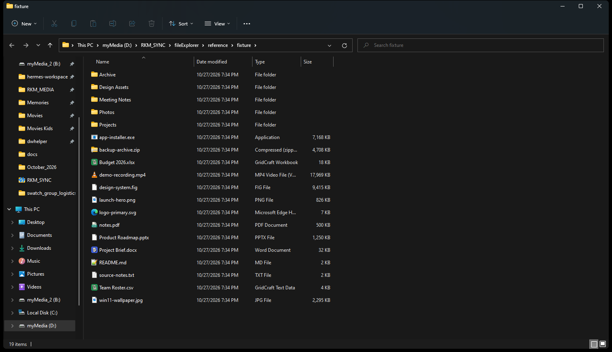

# Windows 11 File Explorer for macOS

A high-fidelity, independently implemented recreation of the Windows 11 File Explorer
interface for macOS. It is a real desktop application built with **Tauri 2**, **Rust**,
**React**, and **TypeScript**, and it browses the real macOS filesystem.

It is not a mockup, a screenshot embed, or a generic file manager with a Windows skin.
Every visible control in the normal file-browser workflow is implemented.

### macOS DMG

A universal macOS DMG was built by the included macOS 14 GitHub Actions workflow:

- **Release:** https://github.com/helloraj1986/win11-explorer-macos/releases/tag/v0.1.0
- **Local file:** `dist-macos/Windows 11 Explorer_0.1.0_universal.dmg`
- **SHA-256:** `AE6A6758D2007DDD954E39DAB7B1665CBED8FB3BC49A026F738F4ACC20B845CA`

The DMG is **ad-hoc signed, not notarized**. Gatekeeper may require right-click → Open
the first time. It contains a universal (arm64 + x86_64) app bundle and an Applications
shortcut. See [docs/MACOS_DMG.md](docs/MACOS_DMG.md) for signing and notarization.




## What is implemented

- **Windows 11 shell layout**: custom title bar, tabs, command bar, breadcrumb address
  bar, search box, navigation pane, details/list/icon views, status bar, and details and
  preview panes.
- **Real filesystem browsing**: directory listing, metadata, hidden files, symlinks,
  volumes, permissions errors, and large directories.
- **Tabs** with independent locations and navigation histories. New, close, switch,
  duplicate, reorder by drag, and restore across restarts.
- **Navigation**: back, forward, up, refresh, breadcrumb navigation, editable absolute
  address bar, invalid-path feedback, and per-tab history.
- **Search**: recursive name search within the current folder, cancellable, bounded, and
  served by Rust. Search results include the containing folder.
- **Views**: Details, List, Large icons, Medium icons, Small icons, Extra large icons,
  Tiles, and Content. Details columns are resizable; headers sort ascending/descending;
  grouping by type, date, or size is supported.
- **Selection**: single, Ctrl/Cmd-click, Shift-range, select all, keyboard navigation,
  and drag/marquee selection. Virtualized rendering keeps huge folders responsive.
- **File operations**: create folder, create text file, create shortcut (symlink), copy,
  cut, paste, rename, duplicate, move, drag to folder, send to Desktop/Documents/Downloads,
  delete to Trash, and permanent delete. Name conflicts offer replace, keep both, skip,
  or cancel. Destructive operations are confirmed.
- **Context menus**: file/folder context menu, blank-area context menu, New/Sort/View/
  Group submenus, and nested Send to. All displayed actions are functional.
- **Details and preview**: metadata, permissions, owner IDs on macOS, folder size scan,
  image preview, text preview, and open actions. Image thumbnails use real file content.
- **Appearance**: Windows 11 dark and light color schemes with system/light/dark mode,
  matching surfaces, borders, hover/selected states, rounded menus, and Fluent-style
  original SVG icons (no emoji).
- **macOS integration**: real home folders, `/Volumes` drives, `/Applications` app list,
  Finder reveal, Terminal, TCC usage descriptions, and macOS permission guidance.
- **Persistence**: tabs, location history, view mode, sorting, grouping, column widths,
  sidebar width, pinned folders, recent items, theme, panes, hidden/extension settings,
  and window size.

## Quick start

### Requirements

- macOS 12 or later (the Tauri code targets macOS 10.15+, but this build was not run on
  macOS; see [Known limitations](#known-limitations)).
- Node.js 22 or 24 and npm.
- Rust stable (1.77.2+) with the macOS target.
- Xcode Command Line Tools: `xcode-select --install`.

### Run in development

```bash
npm install
npm run tauri:dev
```

On macOS, the first access to Desktop, Documents, or Downloads may show a macOS privacy
prompt. Allow it to browse those folders. If access was denied, use the error state's
**Open System Settings** button.

### Build a macOS app and DMG

```bash
npm run tauri:build
# universal:
npm run tauri build -- --target universal-apple-darwin
# fastest, on a Mac:
bash scripts/build-macos-dmg.sh
```

A real `.app`/`.dmg` must be built on macOS (or macOS CI); this Windows workspace cannot
produce one. Full local, universal, signing, notarization, GitHub Actions, Gatekeeper, and
troubleshooting instructions are in **[docs/MACOS_DMG.md](docs/MACOS_DMG.md)**.

Artifacts are written under `src-tauri/target/release/bundle/` (native) or
`src-tauri/target/universal-apple-darwin/release/bundle/` (universal). The checked-in
configuration ad-hoc signs the app for CI; Developer ID signing and notarization are not
configured. Add your Developer ID and notarization credentials before distribution.

### Tests

```bash
npm run typecheck
npm test
npm run test:cargo
npm run build
```

### Development-only start location

To open a specific directory when the app starts:

```bash
WIN11_EXPLORER_START_PATH=/Users/you/Projects npm run tauri:dev
```

This is also how the screenshot and smoke-test workflow opens the disposable fixture
without touching the user's normal folders.

## Architecture

```
src/                       React + TypeScript UI
  components/              Shell, command bar, sidebar, file views, menus, dialogs
  hooks/                   Keyboard, theme, virtual list, marquee, window state
  lib/                     Typed API, formatting, sorting, history, tabs, persistence
  state/explorerStore.ts   Predictable Zustand application store
src-tauri/                 Rust backend
  src/commands.rs          Tauri command boundary and platform launching
  src/listing.rs           Directory reading and metadata
  src/operations.rs        Copy/move/rename/delete/duplicate/conflicts
  src/search.rs            Bounded, cancellable recursive search
  src/metadata.rs          Properties, folder stats, previews, sidebar locations
  src/paths.rs             Path/name validation and safety checks
  src/types.rs             Serialized contracts
docs/                      Reference research, feature matrix, validation, screenshots
reference/                 Evidence captured from Windows 11 and REA
scripts/                   Verification and screenshot tooling
```

The backend owns every filesystem mutation. The UI never invents file entries. All
listing, search, metadata, previews, and operations go through typed Tauri commands.
`src-tauri/src/error.rs` maps I/O failures to user-facing error codes; the UI renders
permission, missing-path, conflict, and generic failures distinctly.

## Reference research

The reference was investigated on a real Windows 11 Pro host (`10.0.22000`, Windows 11
21H2) using:

- Window screenshots captured with Win32 `PrintWindow` and full-screen capture.
- Windows UI Automation geometry and accessibility-tree inspection.
- REA 6.8.0 (`D:\RKM_SYNC\fileExplorer\rea`) for PE resource/import evidence from
  `C:\Windows\explorer.exe`; see [docs/REFERENCE.md](docs/REFERENCE.md).
- Direct interaction with the real Explorer: view changes, context menus, details pane,
  light/dark theme, sort/view/new menus, search, and window resizing.

The reference host predates Explorer tabs (tabs shipped in Windows 11 22H2), so the tab
strip is an informed 22H2/23H2 design. Everything else in the matrix is grounded in
captured evidence or explicitly marked as an approximation.

See:

- [docs/REFERENCE.md](docs/REFERENCE.md) — evidence, measurements, colors, uncertainty.
- [docs/FEATURE_MATRIX.md](docs/FEATURE_MATRIX.md) — status of every studied feature.
- [docs/ARCHITECTURE.md](docs/ARCHITECTURE.md) — design decisions and contracts.
- [docs/MACOS_DMG.md](docs/MACOS_DMG.md) — DMG build, signing, notarization, Gatekeeper.
- [docs/VALIDATION.md](docs/VALIDATION.md) — what was run, what was seen, what was not.
- [docs/DEVELOPMENT_LOG.md](docs/DEVELOPMENT_LOG.md) — concise build log.

## Known limitations

These are honest, intentional boundaries of this build:

- **The macOS app has not been launched in this environment.** The universal `.app`/`.dmg`
  was built successfully on a macOS 14 GitHub Actions runner and verified structurally
  (UDIF/HFS, universal Mach-O, Info.plist, ad-hoc CodeSignature), but this Windows host
  cannot run or screenshot it. Runtime behavior on macOS still needs a Mac smoke test.
- **Tabs** are modeled on Windows 11 22H2 because the reference host (21H2) has no tabs.
  Tab overflow uses horizontal scrolling rather than the 22H2 overflow flyout.
- **Share** does not open the macOS share sheet. It copies the selected path and offers a
  **Reveal in Finder** action so the native share flow can be used. This is labeled in the
  toast.
- **Search is name-based**, not indexed content search. It is recursive and bounded to
  500 results / 8 seconds / 200,000 entries, and skips heavy system directories such as
  `Library`, `.git`, and `node_modules`.
- **No undo stack.** Delete has a confirmation and moves to Trash; rename/copy/move are
  confirmed by their explicit actions. There is no Windows-style Undo Delete.
- **No compression** ("Compressed folder"), **no Gallery**, **no Quick Look**, and no
  PDF preview. These are omitted rather than shown as fake controls.
- **Properties** exposes the General tab only. macOS owner/group IDs and permission bits
  are shown; ACL editing is not implemented.
- **Column filter dropdowns** are not implemented. Sorting and resizing are implemented.
- **Copy/move progress is indeterminate.** Operations run off the UI thread and report
  completion; byte-level progress is not streamed.
- **Open With** is macOS-only and lists `.app` bundles from `/Applications`,
  `/System/Applications`, and `~/Applications`. It was not runtime-tested on macOS.
- **Native window controls** are Windows-style custom controls. They use Tauri window APIs;
  native macOS traffic lights are intentionally not shown.
- **App sandbox** is not enabled. macOS uses TCC folder permissions; Distribution via the
  Mac App Store would require sandbox entitlements and additional review work.
- Deleting `/Applications`, `/System`, `/Library`, and similar protected roots is refused
  for safety.

## Safety and privacy

- No telemetry, analytics, network calls, or bundled file data.
- The app reads only what you navigate to and writes only when you explicitly invoke an
  operation.
- Destructive actions require confirmation.
- Paths are validated; moving/copying a folder into itself is rejected; root, home, and
  system roots are protected from deletion.
- File operations are performed with `std::fs`/`trash` on the Rust side, not in JavaScript.

## License

MIT. This is an independent interface recreation and is not affiliated with, endorsed by,
or sponsored by Microsoft. Windows is a trademark of Microsoft Corporation.
