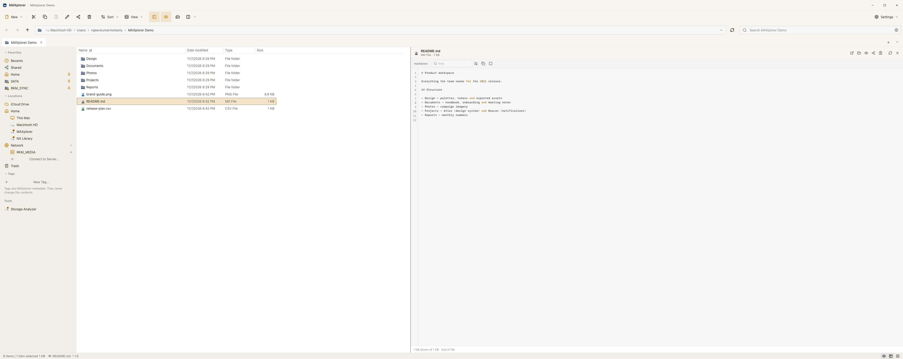
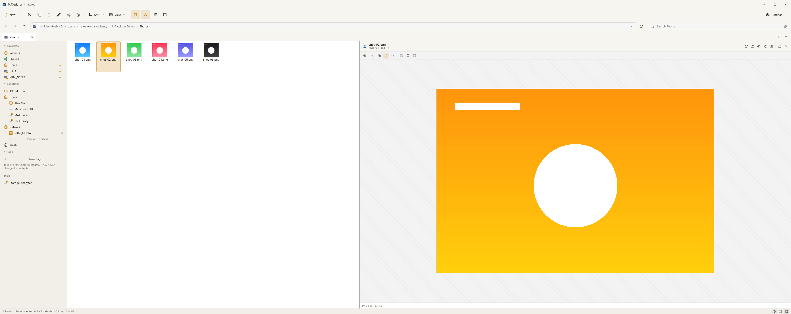

# MAXplorer

**A fast, native file manager for macOS — with the Explorer and Finder you already know.**

MAXplorer is a real desktop application, not a mockup: **Tauri 2**, **Rust**, **React** and
**TypeScript**, browsing the actual macOS filesystem. It ships two interchangeable shells —
Windows 11 Explorer and macOS Finder — each in light and dark, so you keep the muscle memory
you already have.





## Features

- **Dual panes and tabs.** Two independent panes, each with its own tabs, history and view
  settings. Drag, duplicate, reorder, and restore everything on relaunch.
- **Eight view modes.** Extra large, large, medium and small icons, list, details, tiles and
  content, with sortable, resizable columns and grouping by type, date or size.
- **Native preview pane.** Follows the active pane; renders Markdown, source code with line
  numbers, images, PDF (PDFKit), audio/video (AVKit), ZIP contents and folder summaries, and
  hands anything else to macOS Quick Look.
- **Universal Search.** A local SQLite + FTS5 index over names, paths, metadata and extracted
  text (plain text, Markdown, code, PDF, DOCX, XLSX, PPTX). Substring search runs on a
  trigram index, filters and saved searches are built in, and indexing yields to the
  foreground. See [docs/UNIVERSAL_SEARCH.md](docs/UNIVERSAL_SEARCH.md).
- **Storage Analyzer.** A cancellable background scan with real volume capacity, category and
  file-type breakdowns, an interactive treemap, largest files and folders, SHA-256 verified
  duplicate groups, and risk-labelled cleanup that re-validates paths before moving anything
  to the Trash. See [docs/STORAGE_ANALYZER.md](docs/STORAGE_ANALYZER.md).
- **Real file operations.** Copy, cut, paste, rename, duplicate, move, drag to folder, send
  to Desktop/Documents/Downloads and delete to Trash, with conflict handling (replace, keep
  both, skip, cancel) and confirmation for destructive actions.
- **Finder tags** with colour indicators, tag filters and tagging across a multi-selection.
- **Network places.** Saved SMB/AFP/NFS/FTP servers, NetFS mounting through the native macOS
  sign-in sheet, Keychain reuse, Bonjour and NetBIOS discovery, and clear guidance when the
  Local Network or Network Volumes permission is missing.
- **Appearance.** Windows 11 Explorer and macOS Finder themes, each light and dark, plus the
  visual **Theme Creator** for building, previewing, exporting and sharing custom themes and
  icon packs. See [docs/THEME_CREATOR_GUIDE.md](docs/THEME_CREATOR_GUIDE.md).
- **Keyboard first.** `Command+Shift+F` opens Universal Search, `Command+Shift+2…8` switches
  view modes, `Command+Shift+M` toggles dual panes, Space is Quick Look.
- **Local only.** The search index, storage cache, settings and diagnostics stay on your Mac.
  No telemetry, no uploads; the log is one click away in Settings → Diagnostics.

## Installation

### Download

Grab the latest DMG from [Releases](https://github.com/helloraj1986/MAXplorer/releases),
open it, and drag **MAXplorer** to *Applications*.

The build is **ad-hoc signed, not notarized**, so the first launch needs either right-click →
**Open**, or:

```bash
xattr -dr com.apple.quarantine /Applications/MAXplorer.app
```

> The published `v0.1.0` DMG predates the MAXplorer rebrand and the current dual-theme,
> preview, search and storage work. Build from `main` for the latest version.

### Build from source

Requirements: macOS 12 or newer, Xcode Command Line Tools (`xcode-select --install`),
[Rust](https://rustup.rs) 1.88+ and Node.js 22+.

```bash
git clone https://github.com/helloraj1986/MAXplorer.git
cd MAXplorer
npm install

npm run tauri:dev      # run with hot reload
npm run tauri:build    # release .app + .dmg for this Mac
```

For a universal (Apple silicon + Intel) build:

```bash
rustup target add x86_64-apple-darwin
npm run tauri:build -- --target universal-apple-darwin
```

Artifacts land in `src-tauri/target/release/bundle/` (native) or
`src-tauri/target/universal-apple-darwin/release/bundle/` (universal: `macos/MAXplorer.app`
and `dmg/`). Signing and notarization are covered in [docs/MACOS_DMG.md](docs/MACOS_DMG.md).

Application data — search index, storage cache, settings and logs — lives in
`~/Library/Application Support/com.replica.win11explorer`.

## Documentation

| Document | Contents |
| --- | --- |
| [Architecture](docs/ARCHITECTURE.md) | Process model, state, data flow |
| [Universal Search](docs/UNIVERSAL_SEARCH.md) | Index schema, ranking, filters |
| [Preview pane](docs/PREVIEW_PANE.md) | Renderers, layout, Quick Look |
| [Storage Analyzer](docs/STORAGE_ANALYZER.md) | Scan pipeline, treemap, cleanup |
| [Themes](docs/THEMES.md) · [Theme Creator](docs/THEME_CREATOR_GUIDE.md) | Theme architecture and authoring |
| [Network access](docs/NETWORK_ACCESS.md) | SMB/NetFS and macOS permissions |
| [Diagnostics](docs/DIAGNOSTICS.md) | Logs, crash capture, support |
| [Development log](docs/DEVELOPMENT_LOG.md) | Phase-by-phase build history |
| [Handover](HANDOVER.md) | Status, release process, next steps |

## Safety and privacy

MAXplorer reads only what you navigate to and writes only when you invoke an operation.
Permanent deletion always asks first; protected roots (`/`, `/System`, `/Applications`, your
home folder) and copying a folder into itself are refused. Every filesystem mutation happens
in Rust, never in JavaScript. No telemetry, analytics or network calls — the Storage Analyzer
never uploads paths or hashes and never executes what it finds.

## License

MIT — see [LICENSE](LICENSE). MAXplorer is an independent project, not affiliated with,
endorsed by, or sponsored by Microsoft or Apple. Windows and macOS are trademarks of their
respective owners.
