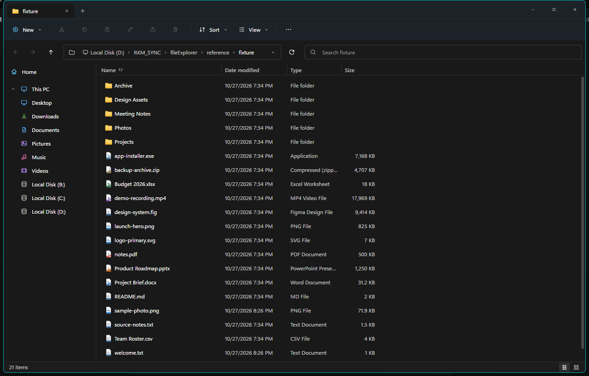
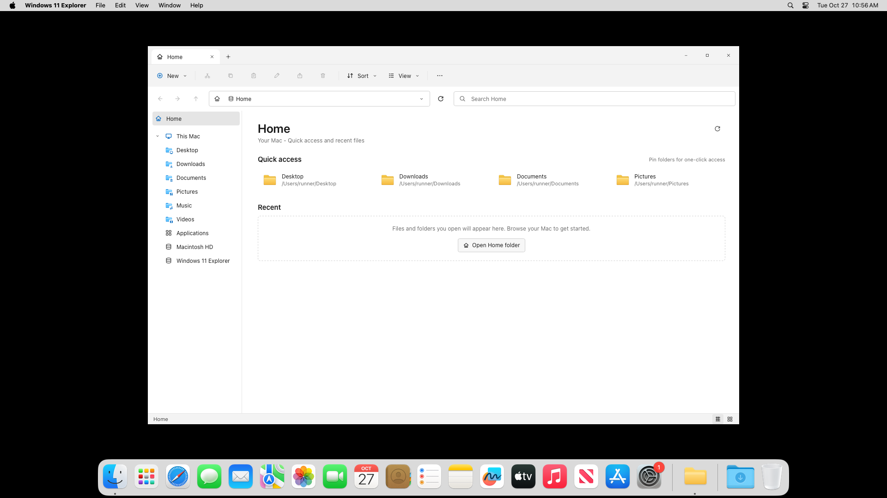

# MAXplorer

**More than just a file manager.**
**Your files. Your way.**

MAXplorer is a powerful, customisable desktop file manager for macOS. It is a real
desktop application built with **Tauri 2**, **Rust**, **React**, and **TypeScript**, and
it browses the real macOS filesystem.

It is not a mockup, a screenshot embed, or a generic file manager with a Windows skin.
Every visible control in the normal file-browser workflow is implemented. MAXplorer
includes two interchangeable visual themes: a Windows Explorer theme and a macOS Finder
theme, each in light and dark appearances.

### macOS DMG

A universal macOS DMG was built by the included macOS 14 GitHub Actions workflow:

- **Release:** https://github.com/helloraj1986/win11-explorer-macos/releases/tag/v0.1.0
- **Local file:** `dist-macos/Windows 11 Explorer_0.1.0_universal.dmg`
- **SHA-256:** `AE6A6758D2007DDD954E39DAB7B1665CBED8FB3BC49A026F738F4ACC20B845CA`

The DMG is **ad-hoc signed, not notarized**. Gatekeeper may require right-click → Open
the first time. It contains a universal (arm64 + x86_64) app bundle and an Applications
shortcut. See [docs/MACOS_DMG.md](docs/MACOS_DMG.md) for signing and notarization.

> **The published `v0.1.0` DMG predates the MAXplorer rebrand.** It uses the previous
> working name and does not contain the dual-theme work or the premium icon system. Build
> from the current `main` (or use a newer CI artifact) to run MAXplorer.




A macOS 14 GitHub Actions smoke run launched the built app from the mounted DMG and
captured the screenshot above (Home view, real `/Users/runner` filesystem).

## What is implemented

- **Three-layer top chrome**: a window-only title bar, one global command bar for file
  operations/organization/workspace/settings, a dedicated navigation and search row, and a
  dedicated tab row. Dual-pane mode repeats the navigation and tab layers per pane.
- **Unified command center**: New, Cut, Copy, Paste, Rename, Share, Delete, Sort, View,
  column configuration, sidebar visibility, the single/dual-pane toggle, and one
  consolidated Settings menu. Commands enable or disable from the active pane's state.
- **Windows 11 and Finder shell layout**: custom title bar, tabs, command bar, breadcrumb
  address bar, search box, navigation pane, details/list/icon views, status bar, and details
  and preview panes.
- **Real filesystem browsing**: directory listing, metadata, hidden files, symlinks,
  volumes, permissions errors, and large directories.
- **Tabs** in their own dedicated row, with independent locations and navigation histories.
  New, close, switch, duplicate, reorder by drag, an all-tabs overflow menu, and restore
  across restarts. Each pane keeps its own tab collection in dual-pane mode.
- **Navigation**: back, forward, up, refresh, breadcrumb navigation, editable absolute
  address bar, invalid-path feedback, and per-tab history.
- **Universal Search**: a toolbar entry point, `Command+Shift+F` command overlay, and a
  full search workspace with scopes, filters, chips, list/grid views, previews, saved
  searches, and history. A local SQLite metadata + FTS5 index searches names, paths,
  metadata, and extracted text from text, PDF, and Office files. A bounded live filesystem
  provider and macOS Spotlight are merged progressively. Duplicate detection verifies
  content with staged fingerprints and SHA-256 hashes. See
  [docs/UNIVERSAL_SEARCH.md](docs/UNIVERSAL_SEARCH.md).
- **Storage Analyzer**: a dedicated workspace opened from the sidebar, command bar, or
  Settings menu without disturbing either pane. Real `statvfs` volume capacity, APFS-aware
  volume classification, a cancellable background scan, category and file-type breakdowns,
  expandable folder tree, largest files/folders, recently changed and old large files,
  an interactive canvas treemap, SHA-256 verified duplicate groups, risk-labelled cleanup
  recommendations, and a review dialog that revalidates exact paths before moving them to
  Trash or permanently deleting them. See [docs/STORAGE_ANALYZER.md](docs/STORAGE_ANALYZER.md).
- **Views**: Details, List, Large icons, Medium icons, Small icons, Extra large icons,
  Tiles, and Content. Details columns are resizable; headers sort ascending/descending;
  grouping by type, date, or size is supported.
- **Selection**: single, Ctrl/Cmd-click, Shift-range, select all, keyboard navigation,
  and drag/marquee selection. Virtualized rendering keeps huge folders responsive.
- **File operations**: create folder, create text file, create shortcut (symlink), copy,
  cut, paste, rename, duplicate, move, drag to folder, send to Desktop/Documents/Downloads,
  delete to Trash, and permanent delete. Name conflicts offer replace, keep both, skip,
  or cancel. Destructive operations are confirmed. Cut entries are dimmed, and a completed
  move reloads the source folder in both panes so it never looks like a copy.
- **Context menus**: file/folder context menu, blank-area context menu, New/Sort/View/
  Group submenus, and nested Send to. All displayed actions are functional.
- **Details and preview**: metadata, permissions, owner IDs on macOS, folder size scan,
  image preview, text preview, and open actions. Image thumbnails use real file content.
- **Real app icons**: `.app` bundles in `/Applications` show their own icon, read from
  `Contents/Resources` (ICNS/PNG), cached, and rendered in every view and both themes.
  Bundles without a readable icon keep a built-in application glyph.
- **Premium icon system**: Lucide functional icons with shared sizing/stroke tokens; a
  typed file-type registry covering documents, images, media, archives, disk images,
  development files, applications, fonts, certificates, databases, and configuration
  files; theme-aware folder, storage, and transfer-status artwork; and lazy image
  thumbnails with deterministic fallbacks. See
  [docs/ICON_SYSTEM.md](docs/ICON_SYSTEM.md).
- **Appearance**: two interchangeable interface themes — Windows 11 Explorer and macOS
  Finder — each with dark and light variants plus system/light/dark mode. The themes share
  all filesystem behavior and differ only in presentation. Finder-style traffic lights,
  toolbar, source-list sidebar, menus, selection, spacing, and typography are included.
  A visual **Theme Creator** adds a guided six-step experience for building, previewing,
  saving, exporting, sharing, and importing custom themes and icon packs without editing
  configuration files. See [docs/THEME_CREATOR_GUIDE.md](docs/THEME_CREATOR_GUIDE.md).
  Lucide is used for interface chrome and original SVG artwork for files and folders
  (no emoji).
- **macOS integration**: real home folders, `/Volumes` drives, `/Applications` app list,
  Finder reveal, Terminal, TCC usage descriptions, and macOS permission guidance.
- **Local diagnostics**: rotating crash log, Rust panic hook with backtrace, React error
  boundary, global unhandled-error capture, **Settings → Reveal diagnostic log**, and
  `npm run logs`. Nothing is uploaded. See [docs/DIAGNOSTICS.md](docs/DIAGNOSTICS.md).
- **Persistent analysis cache**: completed scans are stored in a versioned local SQLite cache
  under app-data and restored after restart or reinstall. Cached drill-down works offline;
  destructive cleanup requires a fresh rescan.
- **Persistence**: tabs, location history, view mode, sorting, grouping, column widths and
  visibility, sidebar width/visibility, pinned folders, recent items, interface theme,
  light/dark theme, text/icon scale, row density, command-bar labels, folder-open behavior,
  delete confirmation, panes, hidden/extension settings, and window size.

## Quick start

### Requirements

- macOS 12 or later (the Tauri code targets macOS 10.15+, but this build was not run on
  macOS; see [Known limitations](#known-limitations)).
- Node.js 22 or 24 and npm.
- Rust stable (1.88+) with the macOS target.
- Xcode Command Line Tools: `xcode-select --install`.

### Run in development

```bash
npm install
npm run tauri:dev
```

On macOS, the first access to Desktop, Documents, or Downloads may show a macOS privacy
prompt. Allow it to browse those folders. If access was denied, use the error state's
**Open System Settings** button.

### Build a macOS app and DMG

```bash
npm run tauri:build
# universal:
npm run tauri build -- --target universal-apple-darwin
# fastest, on a Mac:
bash scripts/build-macos-dmg.sh
```

A real `.app`/`.dmg` must be built on macOS (or macOS CI). Full local, universal,
signing, notarization, GitHub Actions, Gatekeeper, and troubleshooting instructions are in
**[docs/MACOS_DMG.md](docs/MACOS_DMG.md)**.

Artifacts are written under `src-tauri/target/release/bundle/` (native) or
`src-tauri/target/universal-apple-darwin/release/bundle/` (universal). The checked-in
configuration ad-hoc signs the app for CI; Developer ID signing and notarization are not
configured. Add your Developer ID and notarization credentials before distribution.

### Switch interface themes

Open **Settings** from the gear menu at the right of the command bar and choose
**Settings...**, or press `Command+,` / `Ctrl+,`. The menu contains one Settings entry and
non-settings commands only; the six sections are selected inside the dialog. Appearance is
no longer in the sidebar.

Settings has one dialog with Appearance, Display, Layout, Behavior, Keyboard, and Advanced
sections. The Appearance section shows two preview cards (Windows 11 Explorer and macOS
Finder) and an independent light/dark/system control. The choice is saved immediately and
restored on the next launch; switching never changes the current folder, tabs, history,
selection, search, sorting, or in-flight file operations. See
**[docs/THEMES.md](docs/THEMES.md)** for the theme architecture and how to add another
theme.

### Create your own theme

Open **Settings → Appearance** and choose **Create Your Theme**. The visual creator offers
ready-made looks, colour palettes, automatic matching colours, contrast checks, corner and
spacing choices, icon packs, and a complete live MAXplorer preview. No configuration files
or code are needed.

Saved themes appear in **Your themes** where they can be edited, duplicated, renamed,
exported as `.maxTheme` files, shared, or deleted. Importing a `.maxTheme` or `.maxIcons`
package validates it, previews it, and installs it with one click. The beginner guide is
**[docs/THEME_CREATOR_GUIDE.md](docs/THEME_CREATOR_GUIDE.md)**; the developer schema is
**[docs/THEME_PACKAGE_SPEC.md](docs/THEME_PACKAGE_SPEC.md)**.

### Theme files and AI agents

Any AI agent or external tool can create a `.maxTheme` file without MAXplorer or a build
step. The agent should follow:

- **[docs/AGENT_THEME_AUTHORING.md](docs/AGENT_THEME_AUTHORING.md)** — short copyable
  checklist and safe-authoring rules.
- **[docs/THEME_PACKAGE_SPEC.md](docs/THEME_PACKAGE_SPEC.md)** — authoritative schema,
  validation, token allowlist, and package format.

`.maxTheme` files are strict JSON, so `//` and `/* */` comments are invalid. Put notes in
the ignored `_comments` object at the package root instead:

```json
"_comments": {
  "about": "Notes for humans and AI agents.",
  "specification": "docs/THEME_PACKAGE_SPEC.md"
}
```

An annotated example is available at
[`themes/midnight-black-colour-pop.maxTheme`](themes/midnight-black-colour-pop.maxTheme).
Validate any generated package with the application parser:

```bash
npm run theme:validate -- themes/midnight-black-colour-pop.maxTheme
```

The generated file is installed through **Appearance → Import theme → Preview → Install**.
No manifest editing, extraction, or asset placement is required.

### Tests

```bash
npm run typecheck
npm test
npm run test:cargo
npm run build
```

### Development-only start location

To open a specific directory when the app starts:

```bash
WIN11_EXPLORER_START_PATH=/Users/you/Projects npm run tauri:dev
```

This is also how the screenshot and smoke-test workflow opens the disposable fixture
without touching the user's normal folders.

## Architecture

```
src/                       React + TypeScript UI
  components/              Shell, three-layer chrome, command bar, tabs, sidebar,
                           file views, menus, settings/dialogs
    icons/                 AppIcon, FileTypeIcon, FolderIcon, StorageIcon, SyncStatusIcon
  hooks/                   Keyboard, theme, virtual list, marquee, window state
  lib/                     Typed API, formatting, sorting, history, tabs, persistence, theme
    icons/                 File-type registry, native icon service, thumbnail service
  state/explorerStore.ts   Predictable Zustand application store
  styles/                  tokens.css (design tokens), app.css, finder.css (Finder overrides)
src-tauri/                 Rust backend
  src/commands.rs          Tauri command boundary and platform launching
  src/listing.rs           Directory reading and metadata
  src/operations.rs        Copy/move/rename/delete/duplicate/conflicts
  src/search/              SQLite index, FTS5, extraction, indexing, live/Spotlight search
  src/metadata.rs          Properties, folder stats, previews, sidebar locations
  src/paths.rs             Path/name validation and safety checks
  src/types.rs             Serialized contracts
docs/                      Reference research, feature matrix, validation, screenshots
themes/                    Ready-to-import .maxTheme examples and annotations
branding/                  Canonical SVG artwork and high-resolution master icon
reference/                 Evidence captured from Windows 11 and REA
scripts/                   Verification, screenshot, and theme-validation tooling
```

The icon artwork, colour palette, regeneration command, and the bundle-identifier
compatibility decision are documented in [docs/BRANDING.md](docs/BRANDING.md) and
[branding/README.md](branding/README.md).

The backend owns every filesystem mutation. The UI never invents file entries. All
listing, search, metadata, previews, and operations go through typed Tauri commands.
`src-tauri/src/error.rs` maps I/O failures to user-facing error codes; the UI renders
permission, missing-path, conflict, and generic failures distinctly.

## Reference research

The reference was investigated on a real Windows 11 Pro host (`10.0.22000`, Windows 11
21H2) using:

- Window screenshots captured with Win32 `PrintWindow` and full-screen capture.
- Windows UI Automation geometry and accessibility-tree inspection.
- REA 6.8.0 (`D:\RKM_SYNC\fileExplorer\rea`) for PE resource/import evidence from
  `C:\Windows\explorer.exe`; see [docs/REFERENCE.md](docs/REFERENCE.md).
- Direct interaction with the real Explorer: view changes, context menus, details pane,
  light/dark theme, sort/view/new menus, search, and window resizing.

The reference host predates Explorer tabs (tabs shipped in Windows 11 22H2), so the tab
strip is an informed 22H2/23H2 design. Everything else in the matrix is grounded in
captured evidence or explicitly marked as an approximation.

See:

- [docs/REFERENCE.md](docs/REFERENCE.md) — evidence, measurements, colors, uncertainty.
- [docs/BRANDING.md](docs/BRANDING.md) — product identity, application icon, metadata, and theme-independent branding.
- [docs/FEATURE_MATRIX.md](docs/FEATURE_MATRIX.md) — status of every studied feature.
- [docs/ARCHITECTURE.md](docs/ARCHITECTURE.md) — design decisions and contracts.
- [docs/ICON_SYSTEM.md](docs/ICON_SYSTEM.md) — icon tokens, file registry, native icons, and thumbnails.
- [docs/THEMES.md](docs/THEMES.md) — interface themes, persistence, and adding a theme.
- [docs/THEME_CREATOR_GUIDE.md](docs/THEME_CREATOR_GUIDE.md) — create a theme with no coding.
- [docs/AGENT_THEME_AUTHORING.md](docs/AGENT_THEME_AUTHORING.md) — AI-agent checklist for creating theme files.
- [docs/THEME_PACKAGE_SPEC.md](docs/THEME_PACKAGE_SPEC.md) — `.maxTheme`/`.maxIcons` format.
- [docs/MACOS_DMG.md](docs/MACOS_DMG.md) — DMG build, signing, notarization, Gatekeeper.
- [docs/VALIDATION.md](docs/VALIDATION.md) — what was run, what was seen, what was not.
- [docs/DEVELOPMENT_LOG.md](docs/DEVELOPMENT_LOG.md) — concise build log.
- [HANDOVER.md](HANDOVER.md) — project handover: status, architecture, release process,
  risks, and next steps for a new maintainer.

## Known limitations

These are honest, intentional boundaries of this build:

- **The macOS app runs on a real Mac.** It was built and smoke-launched on macOS 14 CI
  (`docs/screenshots/macos-smoke.png`) and has since been confirmed working interactively
  by the project owner on a Mac. What is still missing is an *automated* macOS interaction
  test suite; the interaction matrix is currently covered by the Windows dev build and the
  Rust tests.
- **Tabs** are modeled on Windows 11 22H2 because the reference host (21H2) has no tabs.
  Narrow tab rows scroll horizontally and expose every tab through an all-tabs menu; this
  is not the exact 22H2 overflow flyout.
- **Share** does not open the macOS share sheet. It copies the selected path and offers a
  **Reveal in Finder** action so the native share flow can be used. This is labeled in the
  toast.
- **Universal Search** indexes text-based formats plus PDF, DOCX, XLSX, and PPTX.
  Scanned PDFs without embedded text report that no searchable text was found; OCR is not
  implemented. Semantic and visual image search are optional capabilities that are not
  implemented in this build and are explicitly reported as disabled rather than faked.
  The index skips heavy system directories such as `Library`, `.git`, `node_modules`, and
  application bundles by default; these can still be reached through a scoped live scan.
- **No undo stack.** Delete has a confirmation and moves to Trash; rename/copy/move are
  confirmed by their explicit actions. There is no Windows-style Undo Delete.
- **No compression** ("Compressed folder"), **no Gallery**, **no Quick Look**, and no
  PDF preview. These are omitted rather than shown as fake controls.
- **Properties** exposes the General tab only. macOS owner/group IDs and permission bits
  are shown; ACL editing is not implemented.
- **Column filter dropdowns** are not implemented. Sorting and resizing are implemented.
- **Copy/move progress is indeterminate.** Operations run off the UI thread and report
  completion; byte-level progress is not streamed.
- **Open With** is macOS-only and lists `.app` bundles from `/Applications`,
  `/System/Applications`, and `~/Applications`. It was not runtime-tested on macOS.
- **Native window controls** are custom. The Windows theme renders Windows-style caption
  controls on the right; the Finder theme renders macOS-style traffic lights on the left.
  Both call the same Tauri window APIs (close/minimize/maximize). They are not AppKit
  `NSWindow` buttons, so hover glyphs and spacing are recreated in CSS.
- **The Finder theme is a web-rendered recreation**, not AppKit. It approximates Finder's
  toolbar, source list, menus, selection, and typography with the existing React
  components. It does not implement Finder's column view, Quick Look, tags, or native
  translucent material; translucency is approximated with opaque tokens and blur where
  WebView2 supports it.
- **Theme sharing is local.** `.maxTheme`/`.maxIcons` exports are written to Downloads and
  the Share action copies the package text; nothing is uploaded automatically. The optional
  description-to-theme feature uses a built-in offline style matcher in this build and does
  not call a remote AI service.
- **Custom themes are token-based.** They can change colours, shape, density, typography
  scale, sidebar/toolbar treatment, and an installed icon pack. They cannot replace
  individual React components or introduce arbitrary CSS.
- **App sandbox** is not enabled. macOS uses TCC folder permissions; Distribution via the
  Mac App Store would require sandbox entitlements and additional review work.
- Deleting `/Applications`, `/System`, `/Library`, and similar protected roots is refused
  for safety. The Storage Analyzer additionally refuses protected system subtrees, volume
  roots, the home folder, and anything that canonical resolution places outside the scanned
  volume. Storage analysis is local-only: filenames, paths, hashes, and reports are never
  uploaded, and discovered files are never executed.

## Safety and privacy

- No telemetry, analytics, network calls, or bundled file data.
- The app reads only what you navigate to and writes only when you explicitly invoke an
  operation.
- Permanent deletion always requires confirmation. Moving items to the Trash confirms by
  default and can be configured in Settings → Behavior.
- Paths are validated; moving/copying a folder into itself is rejected; root, home, and
  system roots are protected from deletion.
- File operations are performed with `std::fs`/`trash` on the Rust side, not in JavaScript.

## License

MIT. MAXplorer is an independent desktop file manager and is not affiliated with,
endorsed by, or sponsored by Microsoft or Apple. Windows and macOS are trademarks of their
respective owners.
