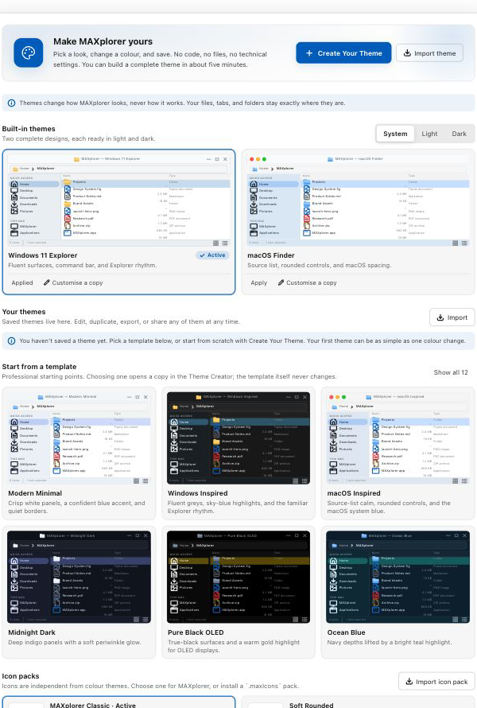
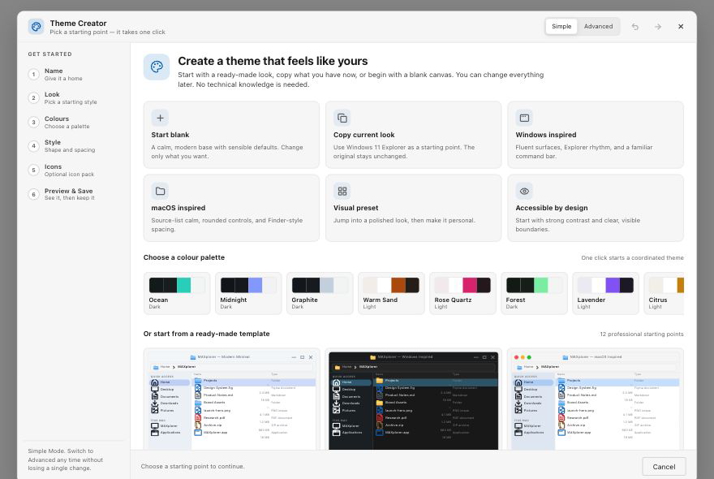
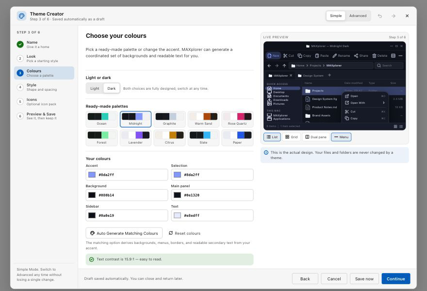
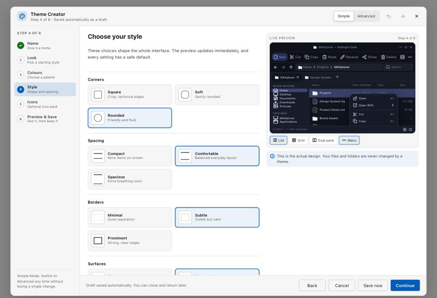
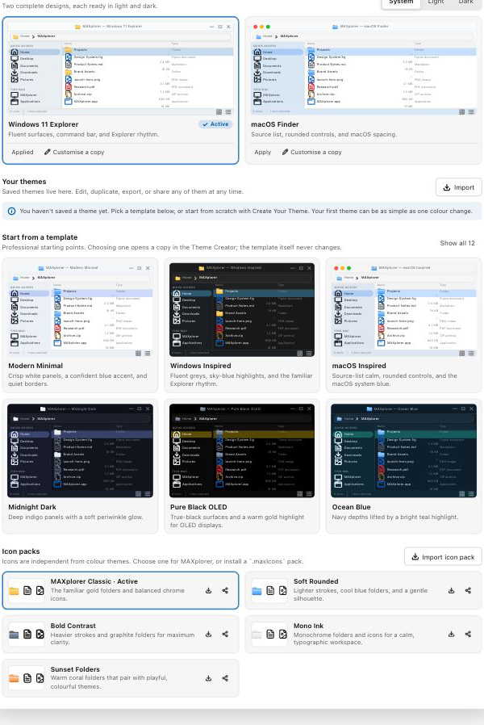

# Create Your Own MAXplorer Theme — No Coding Required

MAXplorer lets you change how the whole file manager looks without editing files,
installing developer tools, or learning a design system. You can create a complete,
shareable theme in about five minutes.

This guide is written for everyone. If you can choose a colour and click Save, you can
build a theme.

---

## What you can change

- The accent colour used by buttons, focus rings, and highlights.
- Backgrounds, panels, the sidebar, selection, and text colours.
- Light or dark appearance.
- Rounded or square corners.
- Compact, comfortable, or spacious spacing.
- Quiet or prominent borders and flat or elevated surfaces.
- Text and icon size.
- The icon pack, independently from the colour theme.
- The starting look: Windows-inspired, macOS-inspired, minimal, glass, pastel, and more.

Every choice updates a real preview of MAXplorer as you work.

---

## The five-minute path

This is the fastest successful route:

1. Open **Appearance**.
2. Click **Create Your Theme**.
3. Choose a ready-made starting look.
4. Change the accent colour.
5. Pick an icon pack.
6. Check the preview.
7. Click **Save Theme**.
8. Click **Export .maxTheme**.

You do not have to visit every step. After the theme has a name you can save at any time.

---

## 1. Open the Theme Creator

Open **Settings** with the gear menu at the right of the command bar, or press
`Command+,` (`Ctrl+,` on Windows), then choose **Appearance**.

The Appearance section is the home of themes. At the top you will see the large
**Create Your Theme** button.

You can also return here later to edit, duplicate, export, share, or delete a saved theme.

---

## 2. Choose where to start

The first screen offers simple starting points:

| Starting point | What it does |
| --- | --- |
| **Start blank** | Gives you a calm, modern design with safe defaults. |
| **Copy current look** | Makes a separate copy of the theme you are using now. |
| **Windows inspired** | Starts with the familiar Explorer layout and colours. |
| **macOS inspired** | Starts with Finder-style spacing and rounded controls. |
| **Visual preset** | Opens a professionally designed starting look. |
| **Accessible by design** | Starts with strong contrast and clear boundaries. |

You can also click any colour palette or template below these choices.

Copying never changes the original. MAXplorer always creates a new theme with its own
name and identity.

### Describe the look you want (optional)

The description box lets you type an idea in everyday language, for example:

- “Create a dark theme with deep blue backgrounds and subtle cyan highlights.”
- “Make MAXplorer look like Windows 11 but with softer colours.”
- “Create a minimal black theme with monochrome icons.”
- “Make a colourful pastel theme.”
- “Give me a futuristic glass-style interface.”

This uses MAXplorer’s built-in style matcher. It works offline, needs no account, and
never sends your words anywhere. You will see a preview before anything is saved. The
rest of the Theme Creator works exactly the same without using this box.

---

## 3. Name your theme

Give the theme a name. For example: **Evening Ink**, **Ocean Desk**, or **Paper Light**.

- The name is required.
- The description and author are optional.
- A unique identity is generated automatically in the background. You never have to
  create or manage it.

You can change the name later.

---

## 4. Choose your look

The **Look** step shows visual cards, not technical options. Each card is a complete,
coordinated starting design.

Pick the one closest to what you want. Choosing a look replaces the colours and style
together, but keeps your theme name.

You can fine-tune the result in the next steps. If you are happy with a look, just press
**Continue**.

---

## 5. Choose your colours

This step is intentionally simple:

- **Light or dark** — choose the appearance you prefer.
- **Ready-made palettes** — click a palette to apply a complete, coordinated set.
- **Accent** — the main colour for buttons and highlights.
- **Selection** — the colour used when files or rows are selected.
- **Background** — the window behind the panels.
- **Main panel** — the file-list surface.
- **Sidebar** — the navigation pane.
- **Text** — the main readable text colour.

### Auto Generate Matching Colours

Change the accent colour, then click **Auto Generate Matching Colours**. MAXplorer
calculates a matching background, panel, sidebar, menu, borders, and readable secondary
text from that one colour.

This is the easiest way to create a theme that looks intentional.

### Contrast help

MAXplorer checks whether text is easy to read. A green message means the contrast is
good. A yellow message means the text may be hard to read.

Click **Fix automatically** and MAXplorer will suggest a readable text colour for you.
Presets and generated palettes already pass the check.

**Reset colours** restores the colours of the starting look. It does not change your
theme name or any other step.

---

## 6. Choose your style

These controls shape the feel of the whole application:

- **Corners** — square, soft, or rounded.
- **Spacing** — compact, comfortable, or spacious.
- **Borders** — minimal, subtle, or prominent.
- **Surfaces** — flat or elevated.
- **Icon size** — small, medium, or large.
- **Text size** — small, default, or large.
- **Sidebar** — plain, tinted, or with stronger contrast.
- **Toolbar** — flat, subtle, or elevated.

Every option has a picture and a short description. There are no numbers to learn.

**Reset style** restores the starting style. **Reset entire design** starts again from a
clean design after asking for confirmation.

---

## 7. Choose your icons (optional)

Icons are separate from colours. You can:

- Follow the icon pack chosen in Appearance.
- Choose any installed pack for this theme.
- Mix a new colour theme with an existing icon pack.

The step previews toolbar icons, navigation icons, folders, and common file types.

You do not need to customise icons to save. The default pack already matches every
built-in theme.

To install someone else’s icon pack, use **Import icon pack** in Appearance. Icon packs
use the `.maxIcons` file type.

---

## 8. Preview everything

The final step shows the complete interface with your design applied:

- title bar and command toolbar;
- tabs and address bar;
- navigation sidebar;
- file list and grid view;
- context menus;
- selected files;
- dual-pane mode.

Use the preview controls to switch between **File list** and **Grid**, turn **Dual pane**
on and off, and show or hide the **Context menu**.

The same live preview appears beside earlier steps, so you always know what you are
changing.

If contrast needs attention, the preview step explains it and offers a one-click fix.

---

## 9. Save your theme

Click **Save Theme**. MAXplorer:

- checks the design;
- creates a complete, valid theme automatically;
- adds it to **Your themes**;
- makes it the active theme;
- keeps a copy of the unfinished design available if you close early.

You can also click **Save now** after naming the theme, even if you have not visited every
step.

After saving, you can:

- **Export .maxTheme** — save a portable file.
- **Share** — copy a ready-to-send version of the theme.
- **Continue customising** — keep editing.
- **Duplicate** — make a separate copy.
- **Create another theme** — start fresh.

### Where exported themes go

On the desktop app, **Export** saves the `.maxTheme` file to your **Downloads** folder
and tells you the exact path. If you prefer, use **Share** to copy the theme text and
paste it into a message.

---

## 10. Share a theme with a friend

1. Open **Appearance**.
2. Find the theme in **Your themes**.
3. Click **Export** to save a `.maxTheme` file, or **Share** to copy the theme text.
4. Send the file or text to your friend.

Nothing is uploaded and no account is required.

---

## 11. Import someone else’s theme

1. Open **Appearance**.
2. Click **Import theme**.
3. Choose a `.maxTheme` file.
4. MAXplorer checks the file and shows a full preview.
5. Click **Install**.

The theme appears in **Your themes** and becomes available immediately. You never need
to unzip anything or move files into folders by hand.

If the file is not a valid theme, MAXplorer explains what is wrong and does not install
it.

---

## Duplicate any theme without changing the original

You can copy:

- a built-in theme;
- a template;
- one of your own saved themes.

Choose **Duplicate**, or **Customise a copy** on a built-in theme. MAXplorer creates a
new theme with a new name and identity. Editing the copy never changes the original.

---

## Undo, reset, and unfinished designs

- **Undo** and **Redo** are in the Theme Creator title bar.
- **Reset colours** and **Reset style** reset a single section.
- **Reset entire design** starts over after asking for confirmation.
- Your work is saved as a draft automatically while you edit.
- If you close MAXplorer before finishing, open the Theme Creator again and choose
  **Continue** on the draft banner.
- **Cancel** leaves the saved theme library untouched.

---

## Worked example: create a personalised dark theme from scratch

Here is a complete example you can follow exactly.

1. Open **Appearance** and click **Create Your Theme**.
2. Choose **Start blank**.
3. Name the theme **Evening Ink**.
4. Optional description: “A quiet dark theme for late-night work.”
5. Click **Continue** to open **Look**, and choose **Midnight Dark**.
6. Open **Colours**. Leave **Dark** selected.
7. Change **Accent** to `#5B8CFF`.
8. Click **Auto Generate Matching Colours**. MAXplorer fills in the background, panel,
   sidebar, menu, and readable secondary text.
9. Check the contrast message. It should be green. If it is yellow, click
   **Fix automatically**.
10. Open **Style**. Choose **Rounded** corners, **Comfortable** spacing, **Subtle**
    borders, and **Elevated** surfaces. Keep medium icons and default text.
11. Open **Icons** and choose **Mono Ink** for a calm, monochrome workspace.
12. Open **Preview & Save**. Try **Grid**, **Dual pane**, and the **Context menu**.
13. Click **Save Theme**.
14. Click **Export .maxTheme**.

You now have a complete dark theme that can be installed on another Mac or shared with a
friend.

---

## The five-minute challenge

A first-time user should be able to complete this without reading technical
documentation:

- [ ] Open Appearance.
- [ ] Select **Create Your Theme**.
- [ ] Choose a preset.
- [ ] Change the accent colour.
- [ ] Select an icon pack.
- [ ] Preview the complete interface.
- [ ] Save the theme.
- [ ] Export it as a `.maxTheme` file.

Also check that duplicating an existing theme creates a separate copy and leaves the
original unchanged.

---

## Keyboard and accessibility

- `Tab` and `Shift+Tab` move through the Theme Creator.
- `Enter` or `Space` activates the focused choice.
- `Escape` closes the creator and keeps the automatic draft.
- Every colour field has a text label and an accessible name.
- All important status messages are written in plain language.
- Contrast warnings help keep text readable.

---

## Troubleshooting

**I cannot find my exported theme.**
Open **Downloads** in Finder. The toast message shows the exact saved path.

**I closed the Theme Creator by mistake.**
Open it again from Appearance. If an unfinished design exists, choose **Continue** on the
draft banner.

**My text is hard to read.**
Return to **Colours**, choose **Auto Generate Matching Colours**, or click **Fix
automatically** next to the contrast message.

**I want the built-in look back.**
Open **Appearance** and click either built-in theme card. Your saved themes remain in
**Your themes**.

**My friend sent text instead of a file.**
Use **Share** on your own theme to see the same format. For importing, ask them to use
**Export** and send the `.maxTheme` file.

**A theme will not install.**
MAXplorer only installs valid MAXplorer theme packages. The preview window explains the
problem; nothing on your Mac is changed.

---

## Related documentation

- [AI agent authoring guide](AGENT_THEME_AUTHORING.md) — a short checklist for creating theme
  files outside MAXplorer.
- [Theme Creator package specification](THEME_PACKAGE_SPEC.md) — for developers who want
  to create themes with configuration files.
- [Interface themes](THEMES.md) — how the built-in Windows and Finder themes work.
- [Icon system](ICON_SYSTEM.md) — how icons, folders, and file artwork are organised.
